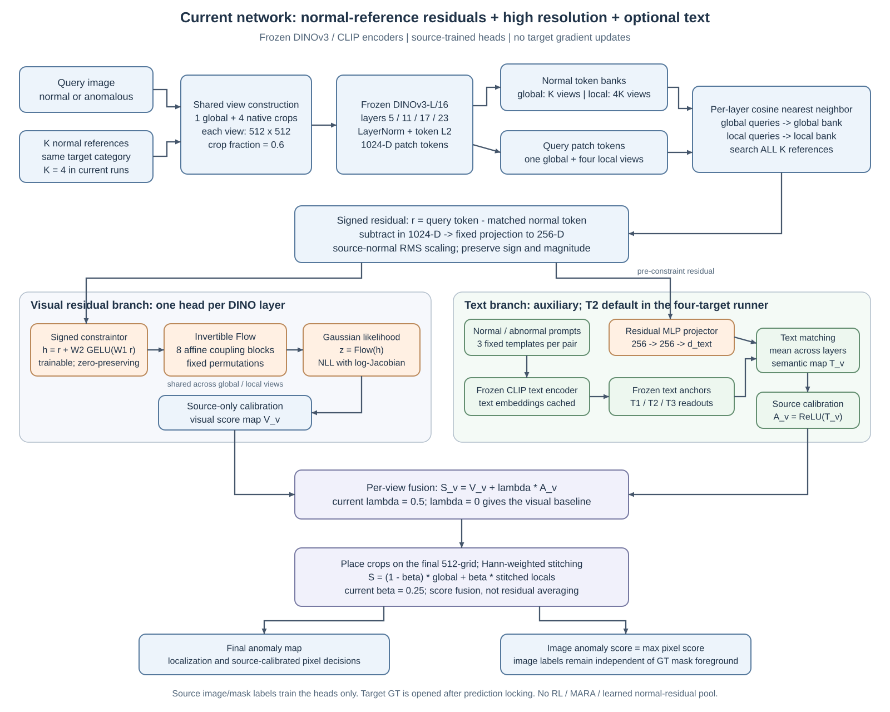
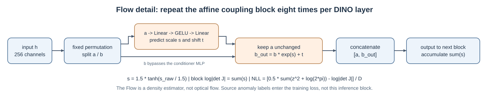

# 论文框架：正常参考残差与高分辨率工业异常检测

> 工作版，更新于2026-11-19。本文档是投稿论文的写作与实验框架，不是已经完成的论文。
> 当前实现按 `e64b255` 及本地相关代码核对；历史数值来自[消融试验](消融试验.md)和[对比实验](对比实验.md)。
> **已有实测、已实现但未收集结果、待验证假设分别标记；未完成实验不填造指标。**

## 1. 论文定位与目前最需要补的证据

### 1.1 一句话说明研究问题

面向未参与训练的工业类别，在只提供少量已知正常参考图、不给目标异常样本且不微调模型的条件下，
先学习待检测图与正常参考之间的差异，再利用原图局部细节提高异常定位能力。

建议英文任务描述：**source-supervised, normal-reference-assisted cross-category / cross-dataset anomaly detection and localization**。

- 源端：使用正常、异常图及二值像素标注训练异常头，默认源数据为VisA。
- 目标端：每类允许K张正常TRAIN参考，默认K=4；不使用目标异常样本训练或更新模型。
- 正常参考的编码与特征池构建是允许的支持集使用，不等于目标梯度微调。
- **不能把整个方案称为源端无监督训练，也不能省略K张参考而直接宣称严格无参考零样本。**

### 1.2 建议标题

中文工作标题：**基于正常参考残差与多尺度高分辨率特征的跨类别工业异常检测与定位**。

英文工作标题：**Normal-Reference Residual Learning with Multi-Scale High-Resolution Features for Cross-Category Industrial Anomaly Detection**。

当前不建议在标题中突出“文本差分优越性”“细粒度缺陷理解”或“SOTA”：已有证据还不支持这些表述。
若后续文本实验给出稳定、独立的语义收益，再决定是否把语言模块纳入标题与主要贡献。

### 1.3 候选贡献与证据边界

| 候选贡献 | 当前证据 | 投稿前还须证明 | 目前可采用的写法 |
|---|---|---|---|
| 学习正常参考残差，减弱类别外观差异 | 旧2×2消融中残差对像素AP提升较大 | 同骨干最近邻、原版ResAD及去模块对照；统一协议复评与多种子 | 基于参考差异构建跨类别检测框架，**不能把已有残差思想本身写成首创** |
| 在残差基础上融合原生局部高分辨率视图 | 旧消融的D−B在三数据集像素AP均为正 | 等算力/大整图分辨率对照、小缺陷分组、拼接与局部权重分析 | 有条件的跨尺度互补，尚不能写成所有类别稳定提升 |
| 引入文本状态/差分作为辅助证据 | λ=0.5时有小幅增益，T2优于T1；多描述优于单对差分但仍不及T2 | λ敏感性、尺度匹配、随机锚/同预算监督头、多种子 | 当前为辅助分支及机制研究，**不宣称文本差分已证明优于普通文本** |

**投稿的关键不只是把现有模块串起来，而是说明相对最接近工作增加了什么、为什么有效、在什么条件下失效。**
ResAD已经研究正常参考残差、约束与分布估计，因此必须把本实现与其差异、同骨干控制和增量收益讲清楚。[ResAD论文](https://proceedings.neurips.cc/paper_files/paper/2024/hash/e2ba11d128034f0c544693374c59e49a-Abstract-Conference.html)

## 2. 按正常投稿论文组织正文

以下按常见视觉/模式识别论文结构安排。最终页数、匿名要求、数据声明及附录规则按拟投期刊/会议调整，当前不预设某个场所的格式。

| 章节 | 需要写清什么 | 对应证据或图表 | 当前状态 |
|---|---|---|---|
| Title / Abstract / Keywords | 研究设定、问题、方法、验证范围、主要结论 | 最终主表及任务协议 | 标题可先定工作版；摘要数字待主实验冻结 |
| 1 Introduction | 新类别外观变化、细小异常丢失、为什么需要先求差异；研究贡献与使用条件 | 任务示意、动机图、贡献—实验映射 | 可写初稿，避免把假设写成结论 |
| 2 Related Work | 正常记忆库、跨类别残差学习、多尺度定位、视觉语言异常检测 | 与最接近方法的差异表 | 需补同协议近期工作与官方实现核对 |
| 3 Method | 任务定义、正常池与残差、约束器/Flow、HR融合、可选文本、训练与推理 | 当前结构图、公式、算法伪代码 | 主干已实现；文本定位待λ研究后冻结 |
| 4 Experimental Setup | 数据划分、K、模型/权重、监督、选模、阈值、评价口径和随机种子 | 数据协议表、实现设置表 | 可写已知设置；最终运行以锁定配置为准 |
| 5 Results and Analysis | 同协议主对比、组件消融、λ研究、参考稳定性、小缺陷、效率与失败案例 | 主表、消融表、曲线、定性图、离线HTML | 已有两轮初步结果，正式证据未齐 |
| 6 Discussion and Limitations | 参考依赖、源监督、未解决的误报、框级GT限制、文本等价性 | 失败类别与机制诊断 | 已有明确问题，必须如实讨论 |
| 7 Conclusion | 回答研究问题，说明已验证贡献和适用边界 | 只总结已完成且统一评价的证据 | 最后写，不预设所有模块有效 |
| Supplementary / Reproducibility | 全类别、种子/参考ID、额外曲线、配置、命令、审计、资源清单 | 补充材料及HTML资源ZIP | 按第11节组织 |

### 2.1 引言的四段逻辑

1. 工业检测遇到新类别时，目标异常样本难获得，而少量正常参考通常更容易准备；明确本文采用该条件。
2. 直接学习图像外观可能混入对象纹理、背景和类别信息；正常参考差异是本研究的切入点。
3. 小异常在整图缩放后容易变弱，原图裁剪保留局部细节；同时带来匹配和误报风险，需要实验验证。
4. 引出本文框架与候选贡献，每条贡献指向具体实验，不用“加入三个模块”代替贡献论证。

### 2.2 摘要写作模板

> 针对【少量正常参考下的新类别异常检测】中的【类别外观变化与细小异常定位】问题，本文研究一种【正常参考残差与原生局部多尺度融合】框架。
> 该方法通过【同层同尺度正常特征匹配与有符号相减】构建差异表示，并使用【残差约束与概率分布估计】产生异常证据。
> 为保留局部细节，进一步【说明实际HR处理】；【文本只在证据充分时写入主要方法贡献】。
> 在【最终源/目标、K、监督条件】下进行评价，取得【统一协议、最终多种子主表中的实际数字】，并通过【关键控制实验】分析贡献与限制。

方括号在正式投稿前用已核实结果替换；当前不能填写“显著优于全部方法”或未完成的多种子统计。

## 3. 当前网络结构图与方法定义

### 3.1 当前实际网络



图1按现有代码绘制。浅蓝为冻结编码/固定处理，浅橙为源端可训练模块，浅绿为文本侧。
四数据集入口目前默认T2；T1/T3是独立文本对照，不表示默认同时运行三个文本头。
图中λ=0.5是已有结果和当前默认值，**不是已经证实最优的融合权重**。

特别注意：

- 正常参考与查询图都输入同一个冻结DINO，先取特征再计算残差。
- 最近邻搜索面向**全部K张参考构成的token池**，不是先选最近的一整张正常图再相减。
- 全局查询只检索正常全局池；局部查询检索所有正常局部视图组成的池，不混淆尺度。
- 文本投影器读取**约束器之前的残差**，不是Flow潜变量或最终异常热图。
- 当前没有新增可学习正常残差池、RL、MARA或可学习提示词；不要把历史/拟议模块画成已实现结构。

### 3.2 符号与参考差异

设待检测图为 $x$，同类别正常支持集为 $\mathcal N_c=\{n_1,\ldots,n_K\}$，视图 $v\in\{G,L_1,\ldots,L_4\}$，DINO层为 $l$。
查询与正常图使用相同视图构建和冻结编码器。当前输入为512×512，patch=16；默认取代码索引5/11/17/23四层。

对单位化token $q_{l,v,p}$，在同层同尺度正常池 $\mathcal B_{l,s(v)}$ 中寻找：

$$
j^*=\arg\max_j\langle q_{l,v,p},b_{l,s(v),j}\rangle,\qquad
r_{l,v,p}=q_{l,v,p}-b_{l,s(v),j^*}.
$$

在完整1024维特征中先匹配、相减；之后固定投影至256维，并使用源正常CAL残差RMS缩放。
残差保留符号与幅度，不在相减后重新做单位归一化。支持集不进行目标梯度更新。

### 3.3 残差约束器和Flow

当前约束器为带恒等跳连的无偏置浅MLP：

$$h=C(r)=r+W_2\,\operatorname{GELU}(W_1r).$$

每个DINO层有各自约束器和Flow；同一层的全局/局部视图共享这些参数。
令 $z=F(h)$，当前Flow由8个带固定置换的仿射耦合块构成，异常分数来自高斯基分布的负对数似然：

$$\ell(h)=\frac{\tfrac12\sum_d(z_d^2+\log(2\pi))-\log|\det J_F(h)|}{D}.$$



图2中，固定置换后拆分为 $a,b$，由 $a$ 的MLP预测 $s,t$；$a$ 保持不变，$b'=b\exp(s)+t$，拼接输出。
当前使用 $s=1.5\tanh(s_{raw}/1.5)$，单块log-Jacobian为 $\sum s$。这里的Flow是可逆概率模型，不是光流。

训练包含正常NLL、正常约束后特征紧凑、异常约束后残差保持，以及相对源批次正常NLL边界的异常分离。
正常紧凑与异常保持作用于 $h=C(r)$，不要与Flow高斯潜变量 $z$ 混用。
异常区域按原生mask覆盖率加权；源异常标签确实参与训练，所以不是纯正常源训练。
本实现属于ResAD-inspired，不能直接称作原版ResAD复现。

### 3.4 高分辨率路径与分数融合

一张原图构建整图G和四个宽/高占比约0.6的重叠原生裁剪，各自缩放到512输入。
高分辨率来自**缩放前裁剪保留的局部细节**，不是单纯放大输出热图。
对每个视图先得到分数，再按裁剪坐标恢复、Hann加权拼接局部图：

$$S=(1-\beta)S_G+\beta\,\operatorname{Stitch}_{Hann}(S_{L_1},\ldots,S_{L_4}),\quad\beta=0.25.$$

不平均不同视图的残差向量。HR查询需要五个视图编码；K张正常参考的编码可按类别缓存，成本应分别报告。
当前默认最终评价图为512×512：裁剪坐标映射回统一评价网格，不代表输出恢复了原图每个像素的独立预测。

### 3.5 文本是辅助证据，当前不承诺细粒度语义

冻结CLIP文本编码器和固定提示，逐层无偏置MLP将约束前残差投影到文本维度。已有实测CLIP文本维度为768，实际由权重决定。
T1=单对单位差分，T2=普通正常/异常状态logit差，T3=24对单位差分的匹配分数均值。
当前同一投影器下，T1/T2仅差固定正尺度；T3平均也可合并成一个固定方向。
这限制了“文本差分增加独立语义能力”的解释，需要第7节的专门对照。

逐视图使用已校准的视觉图 $V_v$ 与文本图 $T_v$：

$$A_v=\max(T_v,0),\qquad S_v=V_v+\lambda A_v.$$

先逐视图取正值并融合，再按3.4节拼接；不能随意改成对拼接后的文本图取正值。
λ=0精确返回视觉基线，λ不是归一化的“文本占比”。正增量不能主动降低原本偏高的视觉分数。

### 3.6 训练与测试写成两段算法

**源训练**：划分源训练类别/留出验证类别→保留独立正常CAL→固定正常参考与残差缓存→训练视觉和文本头→仅按源验证选模→冻结校准与决策。

**目标测试**：提供K张已知正常参考→查询/参考共享编码→匹配并求残差→固定头评分与视图融合→保存并锁定全部预测→之后才读取目标GT评价。
目标GT不流入残差求解、模型选择、λ选择或阈值校准。

## 4. 数据与评价协议必须先冻结

| 数据集 | 本文角色 | 已知规模/标注 | 需要披露 |
|---|---|---|---|
| VisA | 源有监督训练与按类别留出验证 | 已有实验使用其TEST正常/异常及mask；TRAIN正常图作参考 | 不沿用其原始split名称暗示目标测试；明确辅助源训练用法 |
| MVTec | 目标检测与精确定位 | 旧实测1725张、15类，像素GT | 已参与方法开发，不能重新包装成完全未接触的盲测 |
| BTAD | 目标检测与精确定位 | 741张、3类；451正常/290异常；官方11个异常mask全零 | 图像标签与像素前景独立，原样保留全部样本 |
| MPDD | 目标检测与精确定位 | 458张、6类，像素GT | 重点分析支架等困难类，不能只给宏平均 |
| LD | 新增工业应用验证 | 原val转test：251张/4类，69标注正常、182缺陷；矩形框代理mask | 单独报告框级定位；Cam5全为异常，类别图像AUROC为N/A |

LD的训练集合只提供其中已标注正常的参考，不用其缺陷TRAIN图更新模型。
LD标签依据原标注/清单，不依据文件名OK/NG；Cam9正常测试图仅2张，图像指标不稳定性要单列。
LD原val已经用于当前应用评价，不是另采集的独立盲测批次。若要声称独立现场泛化，应另行锁定未参与设计的采集批次。
LD的框内可能含正常像素，因此其像素指标只能称为**框级代理标注定位指标**，不能与前三个像素GT数据集混成一个分割总分。
详见[LD口径](docs/ld_dataset.md)。

### 4.1 公平比较的固定项

固定源类别划分、源CAL、K及参考图ID、预训练权重、随机投影、层选择、输入与评价尺寸、源训练预算、选模规则和GT解码版本。
参考与查询按RGB内容排重；源、目标、支持集不得内容交叉。不同配置必须新目录，保留旧快照。
先源选模/λ，再锁定目标预测；目标测试结果只作最终评价，不按目标类别或数据集分别调λ。

### 4.2 指标与统计

- 主指标：图像I-AUROC/I-AP；精确mask数据集的P-AP和AUPRO；P-AUROC作为补充。
- 运营诊断：源固定阈值下的背景FPR、缺陷像素召回、逐图漏报/误报、定位IoU/Dice；披露阈值来源。
- 当前HTML图像触发使用源CAL像素阈值与图像最大分数比较，**不等于已经单独校准了图像误报率**。
  正式部署实验应独立确定图像级阈值；少量正常CAL下报告阈值不确定性。
- F1-best使用目标最优阈值，仅作描述性诊断，不作选模和部署阈值证据。
- 单类别没有正/负两类时AUROC为N/A；宏平均显示有效类别数，不填0。
- Cam5全为异常，图像AP即使接近满分也不能证明正常/异常区分能力，应同时披露类别构成。
- BTAD全零mask仍属于异常图；像素评价使用原样mask，不删除、不改图像标签。
- 精确定位的逐图IoU/Dice分析需把非空mask异常图、正常图、全零mask异常图分开显示。
- 数据集先分别类别宏平均，再报告跨训练种子的均值±标准差；不将不同类别数或GT类型混成一个不加说明的总分。
- 多种子必须区分头训练随机性与参考抽样随机性；数据样本并非额外独立训练种子。

## 5. 已完成实验：哪些可以放入论文，哪些还需更新

### 5.1 第一轮：高分辨率×残差的2×2消融

来源：[消融试验.md](消融试验.md)，seed42，训练至5/计划15轮，四组各自源选模。
A=无HR/无残差；B=无HR/有残差；C=有HR/无残差；D=有HR/有残差。
下表是该历史运行的完整模型像素AP，单位%；**BTAD保留的是旧版评价值，不是已统一复评的正式主表。**

| 数据集 | A | B | C | D | 残差B−A（点） | HR在残差上D−B（点） |
|---|---:|---:|---:|---:|---:|---:|
| MVTec | 42.28 | 60.63 | 40.45 | 62.69 | +18.35 | +2.06 |
| BTAD（历史口径） | 46.96 | 64.01 | 47.77 | 65.73 | +17.05 | +1.72 |
| MPDD | 32.35 | 35.16 | 31.42 | 41.46 | +2.81 | +6.30 |

允许的初步结论：该运行中残差对定位贡献较大，HR在残差基础上有平均增益；单独加HR不保证提升。
投稿前须用统一图像标签/像素解码重评**全部四组**，并补足同预算训练与多种子。
旧BTAD用mask前景推图像标签，11张全零mask导致标签计数改变；不能把旧I-AUROC直接放入最终主比较。
不同轮次、不同GT解码的旧表不能与下面文本表直接拼接或相减。

### 5.2 第二轮：固定视觉支路的文本对比

来源：[对比实验.md](对比实验.md)，`text_reevaluation_analysis_20261117_114319_522877.zip`。
三文本头均训练15轮；视觉Flow固定为旧D组through5选中的第4轮；T1选中第1轮、T2/T3选中第9轮。
源选模，单种子42，λ固定0.5；2924张目标图全部保留，v3评价。

| 数据集 | 方案 | I-AUROC | P-AP | AUPRO |
|---|---|---:|---:|---:|
| MVTec | V纯视觉 | 92.67 | 63.70 | 94.98 |
| MVTec | T1单对差分 | 93.11 | 63.76 | 95.00 |
| MVTec | T2普通状态文本 | 93.54 | 64.18 | 95.07 |
| MVTec | T3多对平均差分 | 93.26 | 64.05 | 95.04 |
| BTAD | V纯视觉 | 96.06 | 66.57 | 86.31 |
| BTAD | T1单对差分 | 95.92 | 66.65 | 86.40 |
| BTAD | T2普通状态文本 | 95.96 | 67.86 | 86.43 |
| BTAD | T3多对平均差分 | 96.02 | 67.58 | 86.37 |
| MPDD | V纯视觉 | 77.34 | 41.67 | 94.75 |
| MPDD | T1单对差分 | 77.66 | 42.02 | 94.76 |
| MPDD | T2普通状态文本 | 78.41 | 43.07 | 94.80 |
| MPDD | T3多对平均差分 | 77.90 | 42.49 | 94.77 |

| 已回答的问题 | 现有观察 | 论文中应如何表达 |
|---|---|---|
| λ=0.5时文本能否增加定位分数 | T2−V像素AP为+0.48/+1.29/+1.40点 | 当前固定融合下有小幅增益，不能外推其他λ |
| 单对差分是否优于普通状态文本 | T1在三个数据集P-AP均低于T2 | 不支持差分更优；不能隐去不利对照 |
| 更多描述是否有帮助 | T3−T1为+0.28/+0.93/+0.47点，仍低于T2 | 改善单对差分，但方向与幅值一起变化，机制待分离 |
| 文本是否实现语义理解 | 尚无随机锚、可控文本条件定位或类型标注验证 | 当前不足以支持细粒度语义理解结论 |

同一投影器下，归档中T2≈0.3772077×T1；T3平均方向范数≈0.4698。
这些是**训练读出**的尺度差异，不能直接当作校准后文本图或融合占比；λ还需独立研究。
T1训练loss下降但源留出类AUPRO退化，说明训练优化和跨类别泛化并不同步。

### 5.3 已有失败证据

- λ=0.5的T2下，MPDD bracket_brown/black/white的P-AP分别约5.54/8.40/17.02。
- MVTec grid的T2背景FPR约28.37%；高像素AUROC不能代替误报与定位质量分析。
- 热图中主体/纹理存在较宽响应，但颜色不能直接证明反光、油污、参考姿态等物理原因。
  这些仅是待通过参考图、匹配索引、原图/GT进一步核查的解释。

### 5.4 四数据集统一实验与HTML

当前已实现[四数据集训练/评价](docs/four_dataset_training.md)和[离线HTML分析](docs/four_dataset_dashboard.md)，默认读出T2、λ=0.5。
**截至本框架整理时，本文尚未导入该四数据集运行的锁定指标包，因此不填写LD数值，也不把旧三数据集文本表当作四数据集重训结果。**
旧文本实验的固定Flow与四数据集入口重新训练的Flow可能不同；两条运行记录必须分别命名、不能只因模块同名就混表。
λ灵敏度方案已讨论，但尚未形成本文可引用的锁定实测结果，以下仅列为待完成任务。

## 6. 投稿前需要补的实验清单

P0=投稿主结论的必要证据；P1=支撑机制与稳定性；P2=有资源时再扩展。当前仅制定计划，不在本次文档任务中启动训练或修改实验实现。

| 编号/优先级 | 实验与目的 | 需要比较哪些配置 | 固定项与验收证据 |
|---|---|---|---|
| E0 / P0 | 冻结统一评价与复评历史2×2 | A/B/C/D全部按同一最终GT与指标版本复评 | 复用锁定预测；缺预测时用原快照补推理；保存旧指标并注明新评价版本 |
| E1 / P0 | 统一正式主表 | 一个冻结最终方法，逐一评价MVTec/BTAD/MPDD/LD；visual/full同时报告 | 同一源选定模型与超参数跨全部目标；LD另列框级指标、AUROC有效类数 |
| E2 / P0 | 与最接近方法及强基线比较 | ResAD、ResAD++、同DINO最近邻/距离基线、PatchCore K-shot；语言基线分协议组 | 必须报告参考预算、源监督、骨干、目标适配和转导信息；主结论不能来自不公平混表 |
| E3 / P0 | 查明λ是否压低文本增益 | V及T1/T2/T3的同一λ网格，详见第7节 | 不重训、不改头、不改校准；源验证选择λ；固定目标前生成选择记录 |
| E4 / P0 | 排除单次随机性的偶然结果 | 最终方法与关键基线至少3个预先固定训练种子 | 同源划分/同参考集；报告均值±标准差及配对差值；不能只选最好种子 |
| E5 / P0 | 残差/HR正式组件消融 | 同预算A/B/C/D，优先分别给visual和full | 区分历史5轮与正式统一预算；无残差组不得读取参考距离或残差回退 |
| E6 / P1 | 约束与分布估计的实际贡献 | 残差最近邻距离、残差直接Flow、约束器+Flow；有无异常保持/边界项 | 同骨干/层/参考/HR；明确距离基线不是原特征组的隐藏回退 |
| E7 / P1 | HR收益是否只是更多计算 | 整图512、整图更高分辨率、整图+原生裁剪；计算预算匹配版本 | 匹配实测FLOPs或延迟，不用“图像像素数近似相等”冒充同算力 |
| E8 / P1 | 小缺陷及拼接机制 | 按原生GT缺陷面积分组；β=0/0.1/0.25/0.5；边缘/跨裁剪样本 | 面积边界在源端预定，目标只报告；小缺陷像素/连通域召回与背景FPR一起看 |
| E9 / P1 | 正常参考依赖与可重复性 | K=1/2/4；固定K下至少3次独立正常参考抽样 | 单独改变参考ID，固定模型与投影；不要改变DATA_SEED顺便重划训练/验证 |
| E10 / P1 | 骨干与压缩控制 | 同DINO的直接特征/残差；可行时DINOv2与DINOv3；256与不压缩/其他维度 | 固定数据和头预算，区分表征提升与残差方法提升；后两者不能直接复用不兼容权重 |
| E11 / P1 | 文本尺度与语义来源 | 同尺度单/多描述、未再次单位化的均值、范数匹配随机固定锚；必要时同预算二分类头 | 随机锚后重新训练MLP；相同训练预算；不能只在推理时换锚就宣称语义作用 |
| E12 / P0 | 效率与部署成本 | visual/full、G/HR、不同K；正常参考缓存前/后 | 同硬件、预热/同步、batch=1、显存与存储；分开记录参考编码、查询编码、检索和头部耗时 |
| E13 / P0 | 系统的成功与失败案例 | 同图原图/GT/V/full/二值图/误差图；困难支架、grid、小缺陷、正常误报 | 固定源阈值与共用色标；既展示改善也展示退化；与逐图统计一致 |
| E14 / P2 | 更强外部泛化与实际鲁棒性 | 另锁定采集批次、源/目标互换、曝光/姿态变化或参考轻度污染 | 在看目标性能前固定方案；若未开展，不把适用范围写成已解决 |

E4应分别报告“重训完整视觉/文本头”的随机性和“仅文本头种子”的随机性；后者不能冒充整个方法的稳健性。
E9仅变参考时是冻结模型的参考敏感性；若随K重训，另列训练协议，不能与只换参考的结果混为一项。
E6若要证明保留符号的作用，应在正常参考完全相同条件下另比较signed、absolute或距离标量，并说明输入维度/头容量变化。

## 7. 文本与λ：本轮应如何清楚地做对照

### 7.1 先只研究融合，固定现有三个头

| 配置 | 计算 | λ设置 | 独立评价配置数 |
|---|---|---|---:|
| V | 视觉残差图 | 0 | 1 |
| T1融合 | V+λ×单对差分正增量 | 0.1/0.25/0.5/1/2/4 | 6 |
| T2融合 | V+λ×普通状态正增量 | 同上 | 6 |
| T3融合 | V+λ×多描述平均差分正增量 | 同上 | 6 |
| A1/A2/A3诊断 | 分别单独评价真正进入融合的文本正增量图 | 不融合视觉 | 3 |

共19种融合配置+3种文本增量诊断；三个λ=0共用一个V，不重复计成三种方法。
首次复用已完成seed42做问题排查，最终论文用E4补多种子。
保持原顺序：逐视图校准→取文本正值→λ融合→原坐标拼接；不能把取正与拼接顺序互换。
不随λ重新拟合视觉/文本归一化，否则可能抵消λ本身的作用；各λ下的最终操作阈值由同一源正常CAL重新确定。

### 7.2 两类报告，不用目标最优值充当正式结果

1. 同λ曲线：每个数据集分别画P-AP、AUPRO、I-AUROC与背景FPR随λ变化，包含0.5的复现点。
2. 源选λ主表：每个文本方案按源验证融合结果的宏平均`(P-AP+AUPRO)/2`选一个λ，统一用于所有目标。
   平分取较小λ，允许选择0。如果最优落在4且源曲线仍上升，可按事先规则补8；不能因目标集曲线好看临时扩网格。

同时记录GT缺陷区域与背景区域的文本平均增量/覆盖率。提高λ只放大既有响应，不能在文本没有响应的位置生成证据。
若较大λ稳定提升且误报可接受，才支持0.5限制了增益；若各λ都近似V，只能说**当前头与融合下**贡献有限。
若提升λ主要增加背景响应，则说明需要改进证据质量，不能继续用更大权重代替语义验证。

当前三个旧文本头对应旧固定Flow，不能直接与四数据集新重训T2结果拼成同一消融。
给LD补旧头测试时必须复用同一原模型、用独立目标评价记录；已有LD早期CLIP+DINO/MARA入口不是该残差网络的替代。

### 7.3 再单独研究尺度与语义，不把多个因素混在一次实验

- 尺度控制：比较单对单位方向、24对均值再单位化、当前未再单位化的均值；统一温度、损失与训练预算。
- T1/T2等价核查：同投影器下的未单位化差分与普通两状态logit差是同一线性形式，不应作为两种独立表示能力重复计贡献。
- 语义控制：真实文本与同维度/同范数随机固定锚分别从头训练同结构MLP，再按同样源规则选λ。
  若效果接近，新增监督小头可能解释收益；若真实文本更好，仍须跨种子和类别确认。
- 细粒度语言能力：只有额外开展类型/区域语义标注与条件定位评价后，才讨论“裂纹/污渍/缺失”的可控理解；当前二值训练不支持该主张。

文本留在最终方法还是作为附录诊断，应由上述证据决定；λ=0是合法的视觉主模型配置。

## 8. 外部对比模型怎么选，如何避免协议不一致

| 分组 | 建议方法 | 与本工作的关系 | 主表注意事项 |
|---|---|---|---|
| 最接近的跨类别残差方法 | [ResAD，NeurIPS 2024](https://proceedings.neurips.cc/paper_files/paper/2024/hash/e2ba11d128034f0c544693374c59e49a-Abstract-Conference.html)；[ResAD++，2025预印本](https://arxiv.org/abs/2509.23741) | 残差学习的直接先行工作，优先复现 | 核对源数据/监督、K与目标更新；不能只比较不同骨干的论文数字 |
| 内部同骨干强基线 | 冻结DINOv3最近邻距离、原特征Flow、残差Flow | 分离骨干、距离和分布学习的贡献 | 使用相同参考图ID、分辨率、GT与计时方式；这些是本文控制，不是独立外部SOTA |
| 正常支持/记忆库 | [PatchCore，CVPR 2022](https://openaccess.thecvf.com/content/CVPR2022/html/Roth_Towards_Total_Recall_in_Industrial_Anomaly_Detection_CVPR_2022_paper.html) | 正常patch记忆库对照 | 明确K-shot与全量正常TRAIN不同；全量训练另列，不与K=4混同 |
| 视觉语言、少正常参考 | [WinCLIP/WinCLIP+，CVPR 2023](https://openaccess.thecvf.com/content/CVPR2023/html/Jeong_WinCLIP_Zero-Few-Shot_Anomaly_Classification_and_Segmentation_CVPR_2023_paper.html) | 语言与局部窗口/正常参考对照 | 区分零参考与few-normal-shot；骨干和输入预算不同要披露 |
| 源监督、无目标参考语言方法 | [AnomalyCLIP，ICLR 2024](https://proceedings.iclr.cc/paper_files/paper/2024/hash/d7b50b8ac2c781a12f26155f48310d8d-Abstract-Conference.html) | 通用正常/异常文本学习的重要相关工作 | 单列目标参考=0，与本文K=4的信息条件不同；不能只凭数字大小宣称方法更优 |
| 无标签目标集合互评分 | [MuSc，ICLR 2024，作者代码](https://github.com/xrli-U/MuSc) | 另一类跨样本利用目标数据的方案 | 明确目标批次/转导访问，不能当成单图独立推理相同设置 |
| 概率流背景与控制 | [FastFlow，2021预印本](https://arxiv.org/abs/2111.07677) | Flow异常分布估计相关工作 | 当前是逐token仿射耦合实现，不是其2D Flow原样复现；训练设定须另核对 |

上述是基线选择起点，不是完整的2026文献综述。投稿前补齐近期同任务工作，逐项核对官方论文、代码与实际可复现配置。
不在本框架中填其他论文的精度与本文直接排名：先统一或清楚分组参考预算、源监督、目标数据访问、骨干与分辨率。
预训练视觉编码引用[DINOv3技术报告](https://arxiv.org/abs/2508.10104)，冻结骨干不等于异常头没有使用监督。

每条比较至少保存：方法/版本、骨干权重、源标注、目标正常K、是否全量目标正常拟合、是否目标梯度更新、是否读取目标集合、输入尺寸、评价GT版本、阈值来源、种子和参考ID。

## 9. 论文图表清单：每张图回答一个问题

| 图表 | 内容 | 要回答的问题 | 来源/状态 |
|---|---|---|---|
| Figure 1 | 正常参考差异任务与整图缩放/原生裁剪动机 | 为什么先比较正常差异、为什么需要局部细节 | 待从固定样本构建，不能按模型最好结果挑图 |
| Figure 2 | 当前完整网络结构 | 输入、残差、Flow、文本与HR的连接关系 | 本文图1 SVG可用作工作底图，最终按实际方法冻结 |
| Figure 3 | 约束器/Flow或残差空间诊断 | 正常差异是否更集中，异常是否仍可分 | Flow结构底图已有；分布图待实测，二维降维仅定性 |
| Table 1 | 数据集、监督、参考预算、GT类型 | 方法访问了什么数据 | 第4节协议 |
| Table 2 | 同协议主对比 | 跨类别/跨数据集检测定位效果 | E1/E2/E4待完成 |
| Table 3 | 正式2×2与视觉头消融 | 各模块的独立与组合贡献 | 旧结果在第5节，正式版需E0/E5/E6 |
| Figure 4 | λ性能/误报曲线 | 0.5是否压低文本作用 | E3待实测 |
| Figure 5 | K与参考抽样、缺陷面积分组 | 支持集与小缺陷稳定性 | E8/E9待实测 |
| Figure 6 | 同图不同方法的原图/GT/异常图/误差图 | 实际定位改善及代价 | E13与离线HTML导出 |
| Table 4 | 延迟、显存、存储、参考成本 | HR与残差收益付出的代价 | E12待实测 |
| Supplement | 全类别、所有种子、失败案例、配置与HTML资源 | 可复核性及边界 | 全程保存，不只在投稿前补做 |

框级LD图用矩形标注显示，不能绘成精确缺陷轮廓。论文中使用共用色标，图像增强仅用于展示并明确说明。
同一图的visual/full比较不能各自min-max把微小差异放大成明显改进。

## 10. 待填正式主表模板

**下面是投稿主实验待填表，不是已经取得的结果。**最终应给每个数据集的完整方法对照与种子标准差；此处只示意本文方法一行的字段。

| 数据集/GT | 方法与协议 | 正常参考K | I-AUROC | I-AP | P-AUROC | P-AP | AUPRO | 背景FPR | 评价状态 |
|---|---|---:|---|---|---|---|---|---|---|
| MVTec / 像素GT | 最终冻结模型；源VisA监督 | 4 | 待正式实测 | — | — | — | — | — | 不能复制旧单种子不同快照数字 |
| BTAD / 原样像素GT | 同一最终模型 | 4 | 待正式实测 | — | — | — | — | — | 保留11个全零mask |
| MPDD / 像素GT | 同一最终模型 | 4 | 待正式实测 | — | — | — | — | — | 单列支架类表现 |
| LD / 框级代理GT | 同一最终模型 | 4 | 待正式实测 | — | — | — | — | — | Cam5类别I-AUROC为N/A；说明有效类数 |

目标集合中的数值可以描述已经观察到的事实，但在这些目标上反复调方案后，不能又把同一集合称为全新盲测验证。
确需改变λ、K、模型、损失时按新实验版本记录；历史结果保留，不重命名冒充最终配置。

## 11. 所有实验都必须有离线HTML与完整资源包

按照仓库[AGENTS.md](AGENTS.md)，后续每个实验入口应串成：**准备/复用→必要训练或原快照补推理→评价→HTML分析→资源ZIP**。
仅生成日志、Markdown或指标CSV不视为完成实验产物。

当前四数据集统一入口是 `run_four_datasets_with_html.sh`：

- 已有运行：默认`auto`优先读取锁定预测；缺预测时复用原权重补推理，不默默重训。
- 新实验：明确`PIPELINE_MODE=train`与新`WORK_DIR`。本次文档工作不执行该命令。
- λ、组件与多种子新入口尚需各自接入离线HTML；不能假设四数据集包装器已经自动支持所有旧消融协议。
- 本地只有小型分析ZIP、没有完整原图与预测时，不能重建全量逐图定位诊断；需服务器原运行资产。

每个实验至少交付：

```text
<experiment>/
  config / manifest / references / source_selection / prediction_lock
  reports/summary.csv, per_category.csv, contrasts.csv, report.md
  analysis/<seed>/<horizon>/<display_version>/
    index.html                 可离线交互首页
    analysis.json              数据集/类别/逐图数据与来源
    sample_metrics.csv         逐图诊断及阈值口径
    assets or dataset folders  原图、GT、热图、叠加与误差图
    analysis_report.zip        HTML及全部相对路径资源
```

HTML至少有数据集/类别指标、逐图筛选/排序、TP/TN/FP/FN、定位IoU/Dice/召回、原图/GT/visual/full/误差图。
正常图、漏报、误报、检出但定位差、空像素标注、框级标注分别可筛选；单类AUROC显示N/A。
图像分类阈值与像素阈值的关系在页面说明；展示色标不是异常概率，热图不自动解释物理缺陷原因。
资源必须支持解压后直接打开，不依赖CDN、在线模型或外部脚本。
不重写旧训练源码/模型/配置/预测，优先用独立后处理与包装器追加报告。

## 12. 建议执行顺序与投稿前检查

### 阶段A：先把论文证据链固定

1. 确认最终任务名称与监督/参考条件；确定文本是候选辅助还是主贡献。
2. 保存已有两轮实验，完成E0旧2×2统一复评；为两轮旧结果补对应协议的离线HTML。
3. 完成E3的19+3配置λ研究，不同时改变视觉模型；按源验证冻结λ或保留λ=0。

### 阶段B：建立可投稿的主结果

4. 用冻结方案完成E1四目标正式运行与HTML，区分旧固定Flow和新重训Flow。
5. 完成E2最近先行工作/同骨干基线，以及E4至少3个训练种子；将不同目标参考条件分组比较。
6. 完成E5/E6关键组件消融、E7等预算HR控制，以及E12实际效率测量。

### 阶段C：补机制与论文图表

7. 完成E8/E9小缺陷、参考数量/抽样、局部融合分析；文本保留为贡献时完成E11语义控制。
8. 从全量HTML中按预定义规则导出成功/失败图，补齐类别表、指标有效数与GT限制。
9. 再填写摘要数字与贡献措辞，核对方法图、算法、代码、主表属于同一个版本。

### 最低投稿证据检查表

- [ ] 源监督、目标正常K、是否目标更新、是否转导访问均明确。
- [ ] 相对ResAD/ResAD++的实际差异与同骨干收益有证据，不把已有残差思想当首创。
- [ ] 最终主表覆盖同一冻结方法，GT与评价规则一致，LD框级结果分开解释。
- [ ] 关键基线、完整2×2、Flow组件、等预算HR控制、至少3训练种子与效率记录齐全。
- [ ] λ只按源选；文本贡献措辞与λ曲线、尺度/随机锚结果一致。
- [ ] 图像标签独立于mask，BTAD零mask保留，Cam5等单类AUROC按N/A处理。
- [ ] 逐类别与失败案例没有被宏平均隐藏；无根据热图推断物理原因的表述。
- [ ] 配置、参考ID、checkpoint、预测锁、指标、源码版本可追溯；旧运行未覆盖。
- [ ] 每项实验有离线HTML、完整资源ZIP和可复现命令，下载后实际打开核验。
- [ ] 对新目标集/采集批次的独立性、数据授权与适用范围作准确说明。

## 13. 本文档对应的本地材料与文献入口

本地实验依据：[消融试验.md](消融试验.md)、[对比实验.md](对比实验.md)、[四数据集协议](docs/four_dataset_training.md)、
[LD标注说明](docs/ld_dataset.md)、[HTML分析说明](docs/four_dataset_dashboard.md)、[BTAD官方全零mask核对](docs/btad_official_zero_masks.json)。

关键实现：[残差/约束器/Flow](tools/residual_text.py)、[冻结编码与参考匹配](tools/residual_text_runtime.py)、
[文本读出](tools/text_ablation.py)、[四目标实验](train_test_four_datasets.py)、[统一HTML入口](run_four_datasets_with_html.sh)。
早期 `docs/residual_first_hr_text.md` 有距离回退/零轮选择等历史协议说明，**不能代替当前受控消融与四目标实现的协议**。

网络图资源：[完整网络SVG](docs/figures/paper_architecture_current.svg)、[Flow细节SVG](docs/figures/paper_flow_detail.svg)。
正文中的外部文献链接均为作者项目、正式论文页或arXiv原文，整理时已核对标题与公开年份；投稿时按最终模板生成参考文献格式。
